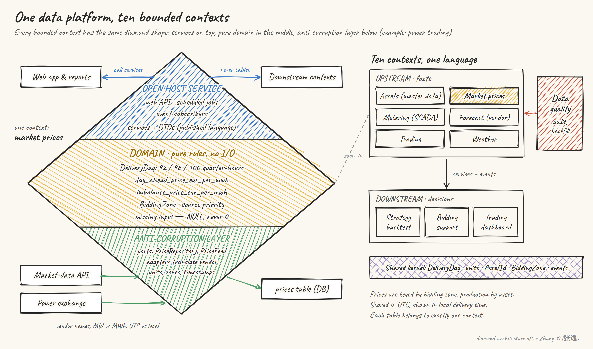

# data-platform-ddd-refactor

A Claude skill that guides a **Domain-Driven Design refactor of a data platform that is already running in production**: ETL scripts, data pipelines, analytics and reporting backends that pull from several sources, store data and compute derived values.

It is not a catalogue of DDD patterns. It is the working method for getting a tangled data platform from "every change breaks a report" to clear bounded contexts, over weeks and many sessions, without breaking production.



## Why it exists

Most DDD material is about transactional systems: orders, aggregates, invariants. Data platforms have different hard problems:

- the same quantity arrives from several vendors under different names, units and time zones;
- business rules live in spreadsheet formulas and in people's heads;
- a silent `0` instead of "missing" becomes a wrong number in a report someone signs off;
- vendors only let you re-fetch the last 7 or 30 days, so gaps must be caught in time;
- and the platform has to keep running every day while you refactor it.

The method in this skill comes from a real refactor of a power-trading data platform (10 bounded contexts, about two weeks, production running every day), generalised to any domain.

## What it does

1. **Assesses fit first.** Before anything moves, it reads the code, writes a dependency baseline and scores ten criteria with evidence from the repo. The verdict is one of: full refactor, lightweight DDD, not now (with cheaper fixes), or an organisational problem where data mesh fits better. "Not worth it" is a valid outcome.
2. **Lets you choose how involved you want to be:**

   | Mode | Good when | Where it stops |
   |---|---|---|
   | Step-by-step | You want to learn the code or DDD | After every sub-step |
   | Standard (default) | Most refactors | Once per step to agree decisions, then only when something new needs you |
   | Fast | You delegate the decisions or have a deadline | Only for the three things below; reports at milestones |

   In every mode, three things always come back to you before they are applied: changes to business outputs, deleting or rewriting stored data, and anything touching production.
3. **Keeps you in charge of the domain.** Names, definitions, sources of truth and boundaries are drafted with evidence and decided by you. Every decision gets a number (`T1` glossary, `C1` context map, `A1` assessment) so later steps can cite why.
4. **Survives many sessions.** A `REFACTOR_PLAN.md` in your repo holds the step table and a "current status" handover, so a new session can continue where the last one stopped.
5. **Never breaks production.** Golden-master checks, a separate dev worktree, parallel runs compared row by row, one kind of change per step, rollback tags on every merge, and rehearsed cutovers.

Two examples:

- **[Example run](docs/example-run.md):** the skill on a deliberately messy test pipeline, with and without the skill.
- **[Real-world case](skills/data-platform-ddd-refactor/examples/power-trading.md):** the power-trading data platform this method came from, sanitised, from assessment to first new feature.

The default order: safety net → glossary → context map → shared kernel → one template context → the other upstream contexts → events and data quality → downstream contexts → storage schema → consumers → first new feature. It explains when to reorder.

## Install

**As a Claude Code plugin:**

```
/plugin marketplace add XinranM25/data-platform-ddd-refactor
/plugin install data-platform-ddd-refactor@data-platform-ddd-refactor
```

**As a plain skill:** copy `skills/data-platform-ddd-refactor/` into `~/.claude/skills/` (all your projects) or `<repo>/.claude/skills/` (one project).

## Use

Start explicitly the first time, from the root of the repository you want to refactor:

```
/data-platform-ddd-refactor our pipeline has become a mess, every change breaks the daily report. where do we start?
```

or describe your situation in your own words; the skill also triggers on its own when the request matches. Once `docs/REFACTOR_PLAN.md` exists, "next step" or "let's continue the refactor" is enough.

## What's inside

```
skills/data-platform-ddd-refactor/
  SKILL.md                    the method: assessment, modes, the loop, rules, steps
  references/
    assessment.md             fit criteria, verdicts, report format
    steps.md                  each step: goal, decisions, done-when, pitfalls; merging to production
    safety-net.md             golden master, parallel runs, cutover rehearsal
    lessons.md                recurring data-platform traps (names, units, time, missing data, sources)
    architecture-styles.md    diamond architecture, mapped to hexagonal and clean
  domains/
    energy.md                 domain pack: European power markets and trading
  examples/
    power-trading.md          a real refactor, sanitised, from assessment to first new feature
  templates/                  REFACTOR_PLAN.md, glossary.md, context-map.md
evals/                        test cases with synthetic repositories
```

## Scope

Built for data platforms. Transactional business systems (orders, bookings, claims) are out of scope for the later steps; for their aggregate design, see the `ddd-core` plugin of [software-design-skills](https://github.com/yonatankarp/software-design-skills), which this skill points to when it finds one.

## Testing

`evals/` holds nine behavioural test cases on small synthetic repositories: a script not worth refactoring, a cold-chain sensor pipeline, a wind-farm pipeline at different steps, an order service (out of scope), a production merge, and a "just do it all" request. In two rounds against Claude without the skill, the skill scored 100% vs 85% and 96% vs 74%; the clearest differences were under pressure (delegated deadlines, production merges) and in scope honesty. Run them with `claude plugin eval` or adapt them.

## Contributing

Domain packs are the easiest way to help: finance and trading, IoT and industrial telemetry, logistics, retail analytics. See `skills/data-platform-ddd-refactor/domains/README.md` for the format.

## Credits

- The diamond (symmetric) architecture is by Zhang Yi (张逸).
- Eric Evans, *Domain-Driven Design* (2003), and Vaughn Vernon, *Implementing Domain-Driven Design* (2013).
- Built and tested with [skill-creator](https://github.com/anthropics/skills).

## License

MIT
